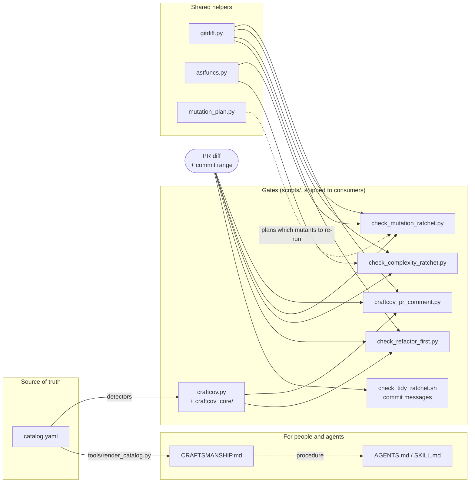

# Architecture

How the pieces fit. For *why* each gate works the way it does, see
[the design notes](design/); for what to run, the [README](../README.md).

## The idea in one picture

`catalog.yaml` is the single source of truth. Everything else either renders it
for people, or checks a diff against it.



The `patch-coverage` gate is not a craft-gate script: it is `diff-cover` run
against *your* coverage report, so it appears only in the CI template.

## Two directories, one rule

| Directory | Holds | Rule |
|---|---|---|
| `scripts/` | The gates and what they import | Exactly what `bootstrap.sh` installs into a consuming repo; a test enforces it |
| `tools/` | `render_catalog.py`, `next_version.py` | This repo's own tooling; never shipped |

Scripts are copied, not installed as a package, so they import each other by
bare name (`from gitdiff import git`). That works because Python puts a script's
own directory first on `sys.path`; `tests/test_scripts_standalone.py` runs each
one by path from another directory to keep it true.

## craftCov's internals

`scripts/craftcov.py` is a thin entry point and a facade over the
`scripts/craftcov_core/` package, so older imports (`from craftcov import ...`)
keep working. The modules, in the order a run uses them:

| Module | Job |
|---|---|
| `catalog` | Load `catalog.yaml`; map each detector rule to its entry |
| `discovery` | Find the Python files to scan, hash them, keep paths relative |
| `adapters` | Run ruff, pylint, vulture and turn their output into raw items |
| `dupes` | Duplicate-code detection (ported, not shelled out) |
| `scopes` | Which class or function a line belongs to |
| `scan` | Run the detectors over files and build findings |
| `cache` | The two state files kept between runs (scan cache, last-report snapshot) |
| `summary` | Totals per heuristic, file, class and library; run-to-run diffs |
| `models` | The values that travel from scan to report (`ScanResults`, `RunContext`, `Timing`, ...) |
| `pipeline` | One whole run: discover, scan what changed, merge corpus findings, scope |
| `render` | Text report, JSON, SARIF, detector listing |
| `cli` | Argument parsing and the top-level flow |

The two gates that need numbers from craftCov (`check_refactor_first.py`,
`craftcov_pr_comment.py`) call its scan functions directly rather than the
command line, and bypass its cache: they scan a throwaway worktree of the base
commit, which a cache would only make stale.

## How a PR is judged

1. **Commits.** `check_tidy_ratchet.sh` reads the commit messages in
   `base..HEAD`: a `tidy(...)` commit, a `test(characterize):` commit, or a
   `Tidy-Exempt:` trailer must exist.
2. **Touched files.** Refactor First scans the merge-base and the head and
   compares per-file craftCov totals.
3. **Touched functions.** The complexity and mutation ratchets map the diff's
   changed lines onto function line ranges (`gitdiff.touched_names`), so only a
   function the diff reaches is held to the ratchet; the rest is grandfathered.
4. **Changed lines.** Patch coverage asks the same question of coverage.

`Tidy-Exempt:` anywhere in the range makes the tidy ratchet, Refactor First and
the complexity ratchet skip entirely. Patch coverage and the mutation ratchet
have no bypass, by design.

## Repo map

```
catalog.yaml              the catalog data: edit this, not the tables in CRAFTSMANSHIP.md
CRAFTSMANSHIP.md          procedure, commit convention, legacy-code method (hand-written)
                          + the two catalog tables (generated)
AGENTS.md                 rules for coding agents working in this repo
CONTRIBUTING.md           how a person contributes
INSTALL.md                the manual steps bootstrap.sh leaves to you
CHANGELOG.md              what changed in each release
DESIGN.md                 index of the design notes
bootstrap.sh              installer/updater for consuming repos
scripts/                  the gates (see above); shipped
tools/                    this repo's own tooling; not shipped
skills/tidy-first/        optional Claude Code skill wrapper around CRAFTSMANSHIP.md
templates/                fragments to merge into a consuming repo: CI jobs, hook,
                          AGENTS snippet, update-check and label workflows, CODEOWNERS
docs/                     this file, the per-gate design notes, operating notes
tests/                    pytest suite; fixtures/ is ground truth for craftCov's detectors
.github/workflows/        this repo's CI and release automation
```

This repo applies its own tooling to itself: `AGENTS.md`,
`.pre-commit-config.yaml` and `.claude/skills/tidy-first/SKILL.md` are produced
by `bash bootstrap.sh .`, and CI fails if re-running it would change anything.
